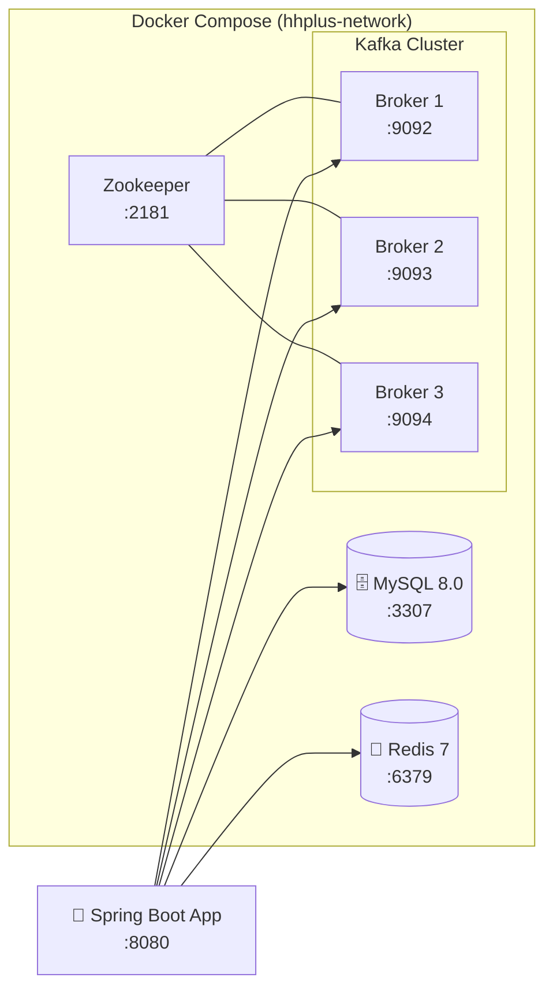
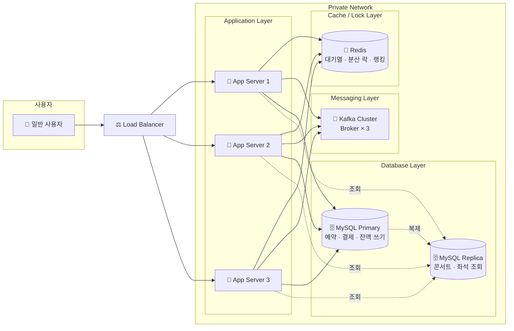
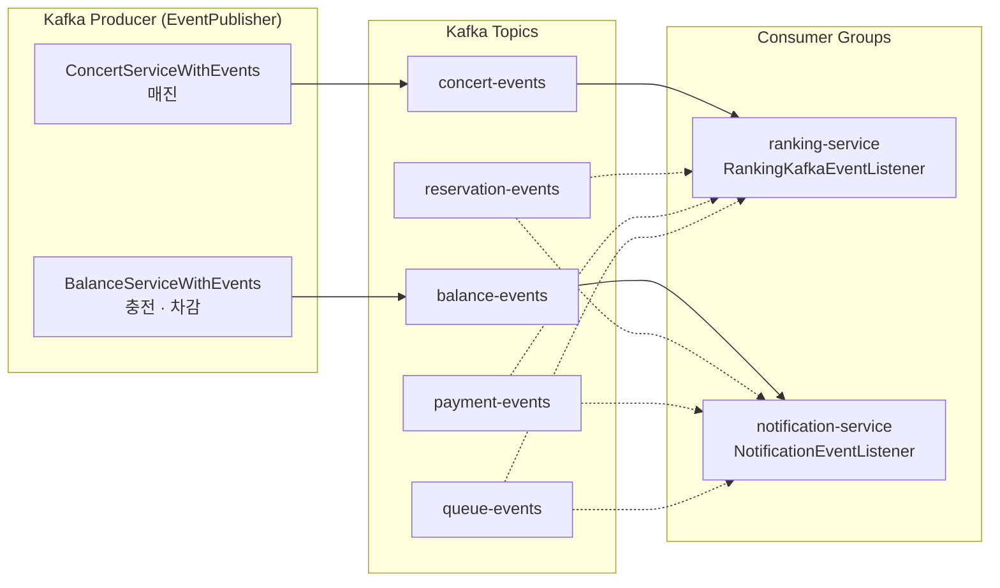

# 시스템 아키텍처

## 📋 개요

콘서트 예약 서비스의 인프라 구성과 애플리케이션 내부 이벤트 흐름을 정리한 문서입니다.

- **1. 로컬 개발 구성**: `docker-compose.yml`로 실제 띄우는 구성
- **2. 운영 목표 구성**: 수평 확장을 전제로 설계한 배포 구성 (미구축)
- **3. 이벤트 흐름**: 도메인 이벤트 → Kafka → Consumer 구조

---

## 1. 로컬 개발 구성 (docker-compose)

| 구성 요소 | 역할 |
|---|---|
| **MySQL** | 콘서트·좌석·예약·결제·잔액·거래 내역 저장, 좌석/잔액 조회 시 비관적 락 |
| **Redis** | 대기열(Sorted Set), 활성 사용자(Set + TTL), 분산 락, 실시간 랭킹(Sorted Set + Lua) |
| **Kafka** | 도메인 이벤트 전달 (브로커 3대, 파티션 3, replication factor 3, min ISR 2) |
| **Zookeeper** | Kafka 클러스터 메타데이터 관리 |

---

## 2. 운영 목표 구성

> 아래는 트래픽 증가를 가정한 **설계안**이며 실제로 구축하지는 않았습니다. 현재 코드에는 Read/Write DB 라우팅이 구현되어 있지 않습니다.

### 설계 포인트
- **App 서버 무상태화**: 대기열 토큰·락·세션 정보를 모두 Redis에 두어 어느 인스턴스로 요청이 가도 동일하게 동작
- **분산 락을 Redis로**: 인스턴스가 여러 대여도 좌석·결제 단위 락이 공유되도록 JVM 락 대신 Redis 사용
- **이벤트로 후처리 분리**: 랭킹·알림·외부 전송을 예약/결제 트랜잭션에서 분리해 핵심 API 응답 시간에 영향이 없도록 함 (예약·결제 이벤트의 Kafka 전환은 진행 중)
- **조회 분산(예정)**: 콘서트·좌석 조회는 Replica로 보내 Primary 부하를 줄이는 방향

---

## 3. 이벤트 흐름

- `EventPublisher`가 `KafkaTemplate`으로 발행 (비동기 `publishEvent` / 동기 `publishEventSync`)
- 현재 Kafka로 실제 발행되는 토픽은 **`balance-events`, `concert-events`** 두 개
- `reservation-events`, `payment-events`, `queue-events`는 **Consumer만 구현된 상태**(점선)이며, 예약 완료 이벤트는 아래 Spring 내부 이벤트로 처리 중

### Spring 내부 이벤트 (트랜잭션 커밋 후 처리)

Kafka와 별개로, 커밋 이후에만 실행되어야 하는 후처리는 `@TransactionalEventListener(phase = AFTER_COMMIT)`로 처리합니다.

| 이벤트 | 리스너 | 처리 |
|---|---|---|
| `ReservationCompletedEvent` | `RankingEventListener` | 예약 속도·인기도 랭킹 갱신 |
| `ConcertSoldOutEvent` | `RankingEventListener` | 매진 속도 랭킹 갱신 |
| `ReservationCompletedEvent` | `DataTransferService` (`@Async`) | 외부 데이터 플랫폼 전송, 실패 시 `FailedDataTransfer` 저장 → `DataRetryService`가 10분 주기 재시도 |

### Consumer Group 분리 이유
- 같은 토픽을 **랭킹**과 **알림**이 각각 전부 받아야 하므로 그룹을 나눔
- 한쪽 Consumer가 느리거나 장애가 나도 다른 쪽 처리에는 영향 없음
